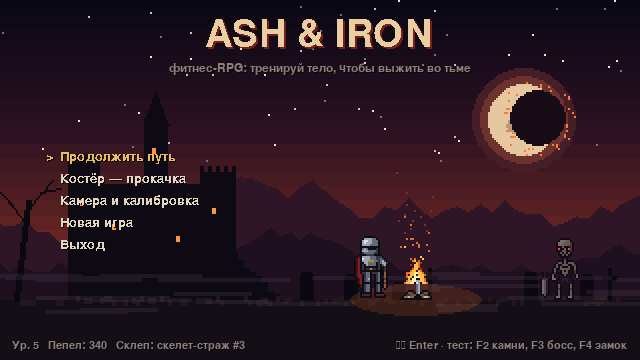
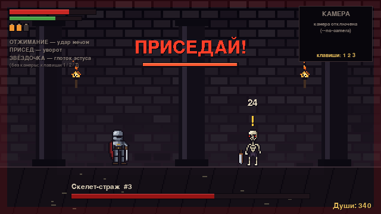
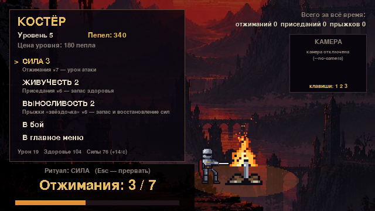
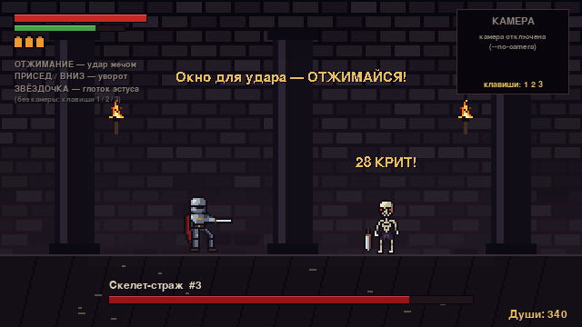
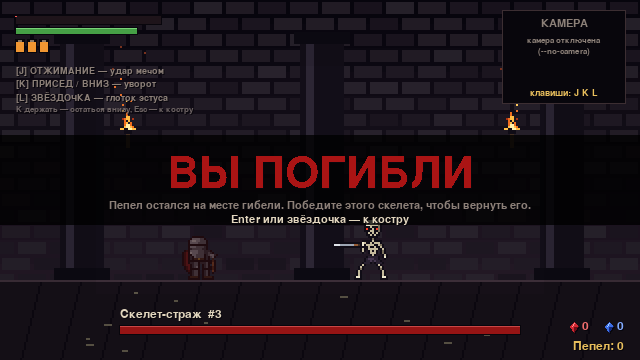
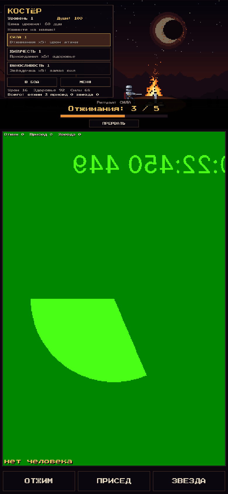
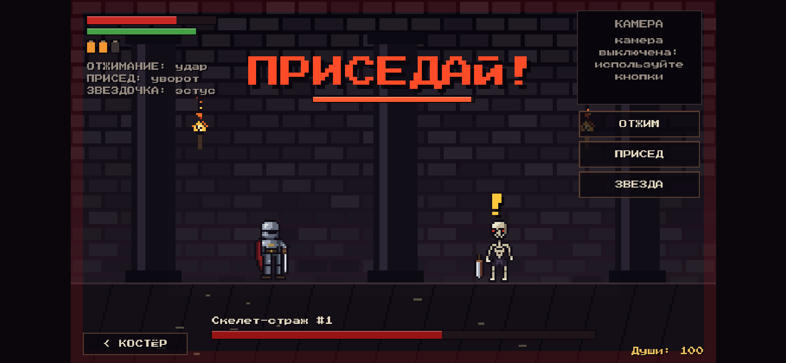

# Пепел и Железо — фитнес-RPG

2D-пиксельная RPG в духе Dark Souls и тёмного фэнтези, где **вся боёвка и прокачка
работают через захват движения**: веб-камера следит за телом (MediaPipe Pose), а игра
засчитывает отжимания, приседания и прыжки «звёздочка».



| Бой: скелет замахивается — приседай! | Костёр: прокачка через ритуал упражнений |
|---|---|
|  |  |
|  |  |

## 📱 Телефон: Android и iPhone

Игра работает на телефоне. Это та же игра, переписанная на JavaScript (`web/`), с тем же артом
и той же логикой распознавания. Камера фронтальная, позу распознаёт MediaPipe прямо на
телефоне, видео никуда не отправляется.

| Портрет: игра сверху, камера снизу | Альбомная ориентация |
|---|---|
|  |  |

**Как поставить:**
- **Android:** скачайте `ash-and-iron.apk` из релиза
  [android-latest](https://github.com/schoolofheroesn1-a11y/Ryan/releases/tag/android-latest)
  и установите (разрешите установку из неизвестных источников). Либо откройте сайт игры в Chrome:
  меню ⋮ → «Установить приложение».
- **iPhone:** откройте сайт игры в Safari, затем «Поделиться» → «На экран Домой».
  Игра запустится во весь экран как приложение.
- **Сайт игры:** `https://schoolofheroesn1-a11y.github.io/Ryan/`. Он заработает после слияния в `main`
  и однократного включения Pages: Settings → Pages → Source: **GitHub Actions**.

**Как играть с телефоном:** поставьте телефон на пол, прислонив к стене, и отойдите на 2–3 м,
чтобы в кадр попадало всё тело. Экран во время игры не гаснет. Без камеры можно жать кнопки
ОТЖИМ / ПРИСЕД / ЗВЕЗДА. Прогресс хранится в памяти телефона.

**Сборка вручную:**
```bash
sh web/fetch_vendor.sh                 # MediaPipe + модель позы в web/vendor (без CDN)
cd web && python -m http.server 8000   # открыть http://localhost:8000 (камера работает на localhost/https)
sh mobile/build_android.sh             # APK (нужны Node 22, JDK 21, Android SDK)
node --test web/tests/*.test.mjs       # тесты мобильной версии
```
Всё это делает CI: `.github/workflows/fitness-rpg.yml` прогоняет тесты, собирает APK в релиз
`android-latest` и публикует сайт на GitHub Pages.

Нативное приложение для App Store собирается только на Mac с аккаунтом Apple Developer, поэтому
на iPhone игра ставится как веб-приложение (PWA). Внешне и по возможностям, включая камеру,
это то же самое.

## Как упражнения управляют игрой

| Упражнение | В бою | Прокачивает у костра |
|---|---|---|
| **Отжимание** (боком к камере) | удар мечом, 20 ед. сил; в окно уязвимости ×1.5 урона (КРИТ) | **СИЛА**: урон |
| **Присед** (боком к камере) | уворот в момент приседа, 15 ед. сил, ~0.9 с неуязвимости | **ЖИВУЧЕСТЬ**: здоровье |
| **Звёздочка** (лицом к камере) | глоток эстуса, +45% здоровья (3 фляги) | **ВЫНОСЛИВОСТЬ**: запас и восстановление сил |

**Цикл боя со скелетом:** ожидание → **замах** (экран краснеет, «ПРИСЕДАЙ!»; два удара
во время замаха его прерывают) → удар → **окно уязвимости** («ОТЖИМАЙСЯ!»). За победу
даются души, за гибель — экран «ВЫ ПОГИБЛИ», и души остаются на месте гибели. Их можно
вернуть, если победить того же скелета.

**Прокачка у костра:** выбираешь характеристику, платишь души и выполняешь ритуал,
то есть N повторений нужного упражнения (4 + текущий уровень, максимум 20). Игра ведёт
общую статистику повторений за всё время.

## Установка и запуск

Нужен Python 3.10–3.12 и веб-камера.

**Windows:** дважды щёлкните `run_windows.bat`. Если Python не установлен, скрипт
поставит его через `winget`, затем установит зависимости и запустит игру.

**Вручную (любая ОС):**
```bash
cd fitness_rpg
python -m pip install -r requirements.txt
python main.py               # с камерой
python main.py --no-camera   # без камеры: 1 — отжимание, 2 — присед, 3 — звёздочка
python main.py --camera 1    # другая камера
```
При первом запуске с камерой скачивается модель позы (~6 МБ) в `models/`.
Клавиши 1/2/3 работают всегда, это удобно для отладки.

**Советы по камере:** ставьте её на уровне пояса, в 2–3 м от себя, тело должно быть целиком
в кадре. Проверить распознавание можно в пункте меню «Камера и калибровка»: там показаны поза,
углы суставов и счётчики.

## Структура

```
main.py                 запуск, --screenshots DIR рендерит сцены в PNG
game/art.py             весь пиксель-арт: спрайты из символьных карт + процедурные фоны
game/exercises.py       распознавание повторений по углам суставов (без зависимости от камеры)
game/motion.py          поток веб-камеры + MediaPipe PoseLandmarker, запасной ввод с клавиатуры
game/player.py          характеристики, цены уровней, сохранение (save.json)
game/scenes.py          главный экран, костёр, бой, калибровка
game/core.py            окно 640×360 (мир 320×180 ×2), цикл, текст, виджеты
tools/generate_art.py   выгрузка арта в assets/*.png (+ увеличенные превью *_x6/x8)
tests/test_game.py      тесты распознавания и боевой логики
web/                    мобильная версия (HTML5 + JS, PWA): js/, assets/, sw.js, manifest
mobile/                 Android-обёртка Capacitor (build_android.sh)
```

Арт рисуется кодом на Python: каждый спрайт задан строками символов, один символ — один
пиксель (см. `HERO_IDLE`, `SKELETON_IDLE` в `game/art.py`). Чтобы поправить персонажа,
отредактируйте карту и запустите `python tools/generate_art.py`.

Тесты: `python -m unittest discover -s tests`
